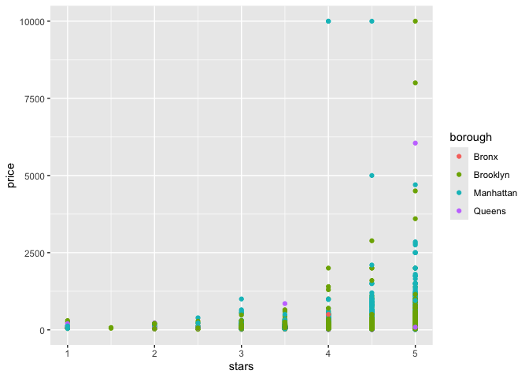
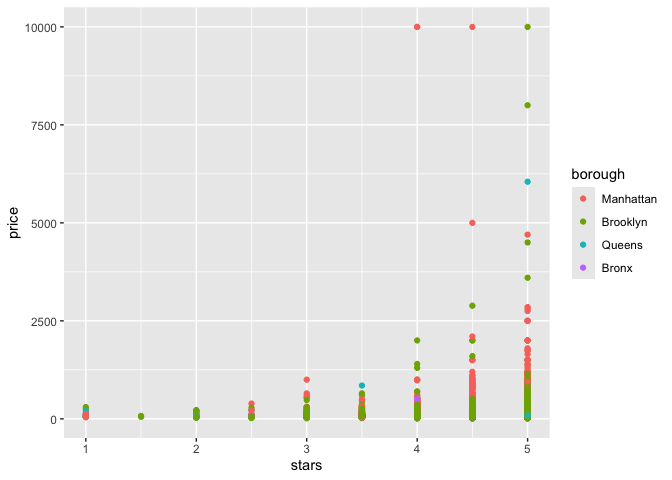
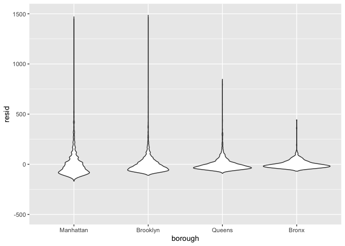
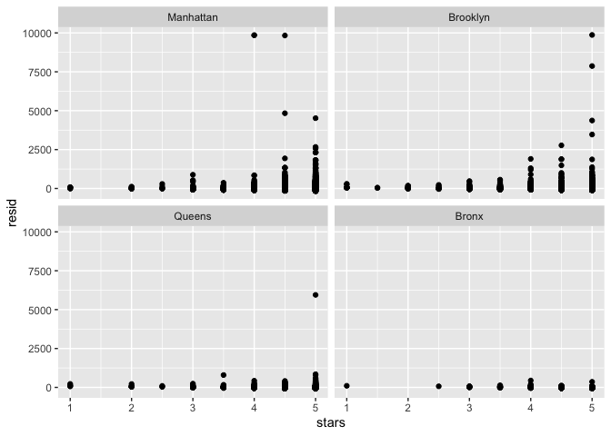
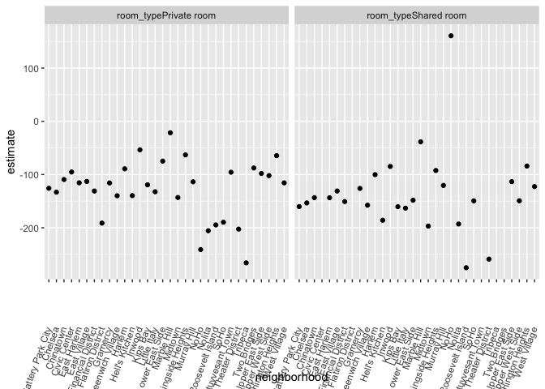

Linear Models
================
Risa Dickerman
2026-11-12

``` r
library(tidyverse)
```

    ## ── Attaching core tidyverse packages ──────────────────────── tidyverse 2.0.0 ──
    ## ✔ dplyr     1.2.1     ✔ readr     2.2.0
    ## ✔ forcats   1.0.1     ✔ stringr   1.6.0
    ## ✔ ggplot2   4.0.3     ✔ tibble    3.3.1
    ## ✔ lubridate 1.9.5     ✔ tidyr     1.3.2
    ## ✔ purrr     1.2.2     
    ## ── Conflicts ────────────────────────────────────────── tidyverse_conflicts() ──
    ## ✖ dplyr::filter() masks stats::filter()
    ## ✖ dplyr::lag()    masks stats::lag()
    ## ℹ Use the conflicted package (<http://conflicted.r-lib.org/>) to force all conflicts to become errors

``` r
library(p8105.datasets)
library(ggplot2)
```

# Airbnb

``` r
data("nyc_airbnb")

nyc_airbnb = 
  nyc_airbnb |> 
  mutate( 
    stars = review_scores_location / 2
  ) |> 
  rename(
    borough = neighbourhood_group,
    neighborhood = neighbourhood
  ) |> 
  filter(
    borough != "Staten Island"
  ) |> 
  select(
    price, stars, borough, neighborhood, room_type
  )

nyc_airbnb
```

    ## # A tibble: 40,492 × 5
    ##    price stars borough neighborhood room_type      
    ##    <dbl> <dbl> <chr>   <chr>        <chr>          
    ##  1    99   5   Bronx   City Island  Private room   
    ##  2   200  NA   Bronx   City Island  Private room   
    ##  3   300  NA   Bronx   City Island  Entire home/apt
    ##  4   125   5   Bronx   City Island  Entire home/apt
    ##  5    69   5   Bronx   City Island  Private room   
    ##  6   125   5   Bronx   City Island  Entire home/apt
    ##  7    85   5   Bronx   City Island  Entire home/apt
    ##  8    39   4.5 Bronx   Allerton     Private room   
    ##  9    95   5   Bronx   Allerton     Entire home/apt
    ## 10   125   4.5 Bronx   Allerton     Entire home/apt
    ## # ℹ 40,482 more rows

eliminating Staten island because we just don’t want to base model on an
item that has very few data points

## Fit a model

``` r
nyc_airbnb |> 
  ggplot(aes(x = stars, y = price, color = borough)) +
  geom_point()
```

    ## Warning: Removed 9962 rows containing missing values or values outside the scale range
    ## (`geom_point()`).

<!-- -->

Let’s fit the model that we care about

\#linear regression

``` r
fit = lm(price ~ stars + borough, data = nyc_airbnb)
```

What we have done? Let’s look at result…

``` r
fit
```

    ## 
    ## Call:
    ## lm(formula = price ~ stars + borough, data = nyc_airbnb)
    ## 
    ## Coefficients:
    ##      (Intercept)             stars   boroughBrooklyn  boroughManhattan  
    ##           -70.41             31.99             40.50             90.25  
    ##    boroughQueens  
    ##            13.21

``` r
summary(fit)
```

    ## 
    ## Call:
    ## lm(formula = price ~ stars + borough, data = nyc_airbnb)
    ## 
    ## Residuals:
    ##    Min     1Q Median     3Q    Max 
    ## -169.8  -64.0  -29.0   20.2 9870.0 
    ## 
    ## Coefficients:
    ##                  Estimate Std. Error t value Pr(>|t|)    
    ## (Intercept)       -70.414     14.021  -5.022 5.14e-07 ***
    ## stars              31.990      2.527  12.657  < 2e-16 ***
    ## boroughBrooklyn    40.500      8.559   4.732 2.23e-06 ***
    ## boroughManhattan   90.254      8.567  10.534  < 2e-16 ***
    ## boroughQueens      13.206      9.065   1.457    0.145    
    ## ---
    ## Signif. codes:  0 '***' 0.001 '**' 0.01 '*' 0.05 '.' 0.1 ' ' 1
    ## 
    ## Residual standard error: 181.5 on 30525 degrees of freedom
    ##   (9962 observations deleted due to missingness)
    ## Multiple R-squared:  0.03423,    Adjusted R-squared:  0.03411 
    ## F-statistic: 270.5 on 4 and 30525 DF,  p-value: < 2.2e-16

``` r
summary(fit)$coef
```

    ##                   Estimate Std. Error   t value     Pr(>|t|)
    ## (Intercept)      -70.41446  14.020697 -5.022180 5.137589e-07
    ## stars             31.98989   2.527500 12.656733 1.269392e-36
    ## boroughBrooklyn   40.50030   8.558724  4.732049 2.232595e-06
    ## boroughManhattan  90.25393   8.567490 10.534465 6.638618e-26
    ## boroughQueens     13.20617   9.064879  1.456850 1.451682e-01

``` r
coef(fit)
```

    ##      (Intercept)            stars  boroughBrooklyn boroughManhattan 
    ##        -70.41446         31.98989         40.50030         90.25393 
    ##    boroughQueens 
    ##         13.20617

``` r
#fitted.values(fit)
#resid(fit)
names(summary(fit))
```

    ##  [1] "call"          "terms"         "residuals"     "coefficients" 
    ##  [5] "aliased"       "sigma"         "df"            "r.squared"    
    ##  [9] "adj.r.squared" "fstatistic"    "cov.unscaled"  "na.action"

Names of things in fit -some stuff that goes along: what is rank, what
is df residual, etc Linear model saves a bunch of stuff in the
background - helpful to know its their

most of the output is bad, but sometimes it’s useful

Let’s look at the results better…

``` r
broom::glance(fit)
```

    ## # A tibble: 1 × 12
    ##   r.squared adj.r.squared sigma statistic   p.value    df   logLik    AIC    BIC
    ##       <dbl>         <dbl> <dbl>     <dbl>     <dbl> <dbl>    <dbl>  <dbl>  <dbl>
    ## 1    0.0342        0.0341  182.      271. 6.73e-229     4 -202113. 4.04e5 4.04e5
    ## # ℹ 3 more variables: deviance <dbl>, df.residual <int>, nobs <int>

``` r
broom::tidy(fit) |> 
  select(-std.error) |> 
  mutate(
    term = str_replace(term, "borough", "Borough: ")
  ) |> 
  knitr::kable(digits = 3)
```

| term               | estimate | statistic | p.value |
|:-------------------|---------:|----------:|--------:|
| (Intercept)        |  -70.414 |    -5.022 |   0.000 |
| stars              |   31.990 |    12.657 |   0.000 |
| Borough: Brooklyn  |   40.500 |     4.732 |   0.000 |
| Borough: Manhattan |   90.254 |    10.534 |   0.000 |
| Borough: Queens    |   13.206 |     1.457 |   0.145 |

bronx is automatically the reference group -broom function super useful,
broom pulls out this useful information -broom::glance(fit) - gives you
very quick look at information that is helpful.

## Be in control of factors:

-borough variable is a character variable: usually converted into factor
variable -factor variable: string label lying on top of number affixed
to it. If not careful: R will do best guess

Change reference category for interested variables -reference group is
one with most airbnb rentals -room type = factor variable, wichever one
is most common

``` r
nyc_airbnb_infreq=
  nyc_airbnb |> 
  mutate(
    borough = fct_infreq(borough),
    room_type = fct_infreq(room_type)
  )
nyc_airbnb_infreq |> 
  ggplot(aes(x = stars, y = price, color = borough)) +
  geom_point()
```

    ## Warning: Removed 9962 rows containing missing values or values outside the scale range
    ## (`geom_point()`).

<!-- -->
-Manhattan \> Brooklyn \> Queens \> Bronx most

Refit model

``` r
fit_infreq= lm(price ~ stars + borough, data = nyc_airbnb_infreq)
fit_infreq
```

    ## 
    ## Call:
    ## lm(formula = price ~ stars + borough, data = nyc_airbnb_infreq)
    ## 
    ## Coefficients:
    ##     (Intercept)            stars  boroughBrooklyn    boroughQueens  
    ##           19.84            31.99           -49.75           -77.05  
    ##    boroughBronx  
    ##          -90.25

``` r
broom::tidy(fit_infreq) |> 
  select(-std.error) |> 
  mutate(term = str_replace(term, "borough", "Borough:")) |> 
  knitr::kable(digits = 3)
```

| term             | estimate | statistic | p.value |
|:-----------------|---------:|----------:|--------:|
| (Intercept)      |   19.839 |     1.628 |   0.104 |
| stars            |   31.990 |    12.657 |   0.000 |
| Borough:Brooklyn |  -49.754 |   -22.262 |   0.000 |
| Borough:Queens   |  -77.048 |   -20.675 |   0.000 |
| Borough:Bronx    |  -90.254 |   -10.534 |   0.000 |

``` r
  broom::glance(fit_infreq)
```

    ## # A tibble: 1 × 12
    ##   r.squared adj.r.squared sigma statistic   p.value    df   logLik    AIC    BIC
    ##       <dbl>         <dbl> <dbl>     <dbl>     <dbl> <dbl>    <dbl>  <dbl>  <dbl>
    ## 1    0.0342        0.0341  182.      271. 6.73e-229     4 -202113. 4.04e5 4.04e5
    ## # ℹ 3 more variables: deviance <dbl>, df.residual <int>, nobs <int>

-previously comparing everything to the Bronx, now comparing everything
to Manhattan -hasn’t substantially changed what is happening

## Diagnostics

-up until this point doing residuals of fit -want variables and tack on
residuals and fitted values diagnostics is basically “look at the
residuals”

``` r
modelr::add_residuals(nyc_airbnb_infreq, fit)
```

    ## # A tibble: 40,492 × 6
    ##    price stars borough neighborhood room_type        resid
    ##    <dbl> <dbl> <fct>   <chr>        <fct>            <dbl>
    ##  1    99   5   Bronx   City Island  Private room      9.47
    ##  2   200  NA   Bronx   City Island  Private room     NA   
    ##  3   300  NA   Bronx   City Island  Entire home/apt  NA   
    ##  4   125   5   Bronx   City Island  Entire home/apt  35.5 
    ##  5    69   5   Bronx   City Island  Private room    -20.5 
    ##  6   125   5   Bronx   City Island  Entire home/apt  35.5 
    ##  7    85   5   Bronx   City Island  Entire home/apt  -4.53
    ##  8    39   4.5 Bronx   Allerton     Private room    -34.5 
    ##  9    95   5   Bronx   Allerton     Entire home/apt   5.47
    ## 10   125   4.5 Bronx   Allerton     Entire home/apt  51.5 
    ## # ℹ 40,482 more rows

Adding in a column called resid: worry about residuals and residual
distribution now have residuals based on model fit: distribution of
residuals

We can look at residuals

``` r
nyc_airbnb_infreq |> 
  modelr::add_residuals(fit_infreq) |> 
  ggplot(aes(x = borough, y = resid)) +
  geom_violin() +
  ylim(-500, 1500)
```

    ## Warning: Removed 9993 rows containing non-finite outside the scale range
    ## (`stat_ydensity()`).

<!-- -->

``` r
nyc_airbnb_infreq |> 
  modelr::add_residuals(fit_infreq) |> 
  ggplot(aes(x = stars, y = resid)) +
  geom_point() +
  facet_wrap(. ~ borough)
```

    ## Warning: Removed 9962 rows containing missing values or values outside the scale range
    ## (`geom_point()`).

<!-- --> model
will have outliers. But the residuals seem to be incredibly large
-issues that come in because we have huge outliers \> some issue in
model try to find error

Residuals are skewed: -much more spread in 5 stars vs 3 stars

With regression with large samples everything becomes equally
distributed -shouldn’t trust CI that come out of this

## Hypothesis testing

``` r
fit_infreq |> 
broom::tidy() |> 
  mutate(term = str_replace(term, "borough", "Borough: ")) |> 
  knitr::kable(digits = 3)
```

| term              | estimate | std.error | statistic | p.value |
|:------------------|---------:|----------:|----------:|--------:|
| (Intercept)       |   19.839 |    12.189 |     1.628 |   0.104 |
| stars             |   31.990 |     2.527 |    12.657 |   0.000 |
| Borough: Brooklyn |  -49.754 |     2.235 |   -22.262 |   0.000 |
| Borough: Queens   |  -77.048 |     3.727 |   -20.675 |   0.000 |
| Borough: Bronx    |  -90.254 |     8.567 |   -10.534 |   0.000 |

R doing hypothesis test on estimate with standard error, statistics, p
value -can also do a p test Categorical predictor with mult levels: not
ask if individual levels differ from the reference group -if predictor
or categorical value as a whole is significnt in the context of my model

broom::tidy() does t test by default

What about the significance of “borough” F test or ANOVA -fit_null =
lm(price ~ stars) -if null hypothesis borough is not associated with
price -alternative model: lm(price ~ stars + borugh, data = nyc_airbnb)

Permutation testing - when you don’t trust the assumptions you should
use this Is brough significant: can’t look at individual values need to
look at whole thing

Try testing nested model

``` r
fit_infreq_null = lm(price ~ stars, data = nyc_airbnb)
fit_infreq_alt = lm(price ~ stars + borough, data = nyc_airbnb)
  
anova(fit_infreq_null, fit_infreq_alt) |> 
  broom::tidy()
```

    ## # A tibble: 2 × 7
    ##   term                    df.residual     rss    df   sumsq statistic    p.value
    ##   <chr>                         <dbl>   <dbl> <dbl>   <dbl>     <dbl>      <dbl>
    ## 1 price ~ stars                 30528  1.03e9    NA NA            NA  NA        
    ## 2 price ~ stars + borough       30525  1.01e9     3  2.53e7      256.  7.84e-164

## Nesting data, fit models

Fit interactions: slope on stars and boroughs -interactions important,
complicated to understand

different from nesting models -

``` r
fit_nest =
  nyc_airbnb_infreq |> 
  lm(price ~ stars * borough + room_type, data = _) |> 
  broom::tidy() |> 
  knitr::kable(digits = 3)

fit_nest
```

| term                  | estimate | std.error | statistic | p.value |
|:----------------------|---------:|----------:|----------:|--------:|
| (Intercept)           |   75.309 |    19.083 |     3.946 |   0.000 |
| stars                 |   29.649 |     3.961 |     7.486 |   0.000 |
| boroughBrooklyn       |    6.064 |    24.785 |     0.245 |   0.807 |
| boroughQueens         |   51.144 |    40.042 |     1.277 |   0.202 |
| boroughBronx          |   52.644 |    76.761 |     0.686 |   0.493 |
| room_typePrivate room | -104.714 |     2.050 |   -51.088 |   0.000 |
| room_typeShared room  | -129.547 |     6.148 |   -21.072 |   0.000 |
| stars:boroughBrooklyn |   -9.754 |     5.226 |    -1.866 |   0.062 |
| stars:boroughQueens   |  -22.699 |     8.522 |    -2.664 |   0.008 |
| stars:boroughBronx    |  -25.440 |    17.102 |    -1.488 |   0.137 |

looking at relation does stars differ if its in Brooklyn vs Manhattan
-how does reference of room type differ from reference category: -shared
room type for Manhattan seems to have a much cheaper type -difference
between private room and entire apartment in Brooklyn -take overall
effect and add to the interested data point Framework of interactions:
assess stat sig, compare stat with interactions to not to see if it fits
-test important and unimportant

Pretty formal and complicated

``` r
fit = lm(price ~ stars * borough + room_type * borough, data = nyc_airbnb_infreq) |> 
  broom::tidy()

fit
```

    ## # A tibble: 16 × 5
    ##    term                                  estimate std.error statistic  p.value
    ##    <chr>                                    <dbl>     <dbl>     <dbl>    <dbl>
    ##  1 (Intercept)                              95.7      19.2     4.99   6.13e- 7
    ##  2 stars                                    27.1       3.96    6.84   8.20e-12
    ##  3 boroughBrooklyn                         -26.1      25.1    -1.04   2.99e- 1
    ##  4 boroughQueens                            -4.12     40.7    -0.101  9.19e- 1
    ##  5 boroughBronx                             -5.63     77.8    -0.0723 9.42e- 1
    ##  6 room_typePrivate room                  -124.        3.00  -41.5    0       
    ##  7 room_typeShared room                   -154.        8.69  -17.7    1.42e-69
    ##  8 stars:boroughBrooklyn                    -6.14      5.24   -1.17   2.41e- 1
    ##  9 stars:boroughQueens                     -17.5       8.54   -2.04   4.09e- 2
    ## 10 stars:boroughBronx                      -22.7      17.1    -1.33   1.85e- 1
    ## 11 boroughBrooklyn:room_typePrivate room    32.0       4.33    7.39   1.55e-13
    ## 12 boroughQueens:room_typePrivate room      54.9       7.46    7.37   1.81e-13
    ## 13 boroughBronx:room_typePrivate room       71.3      18.0     3.96   7.54e- 5
    ## 14 boroughBrooklyn:room_typeShared room     47.8      13.9     3.44   5.83e- 4
    ## 15 boroughQueens:room_typeShared room       58.7      17.9     3.28   1.05e- 3
    ## 16 boroughBronx:room_typeShared room        83.1      42.5     1.96   5.03e- 2

This is more exploratory but maybe easier to understand:

``` r
nyc_airbnb |> 
  nest(data = -borough)
```

    ## # A tibble: 4 × 2
    ##   borough   data                 
    ##   <chr>     <list>               
    ## 1 Bronx     <tibble [649 × 4]>   
    ## 2 Queens    <tibble [3,821 × 4]> 
    ## 3 Brooklyn  <tibble [16,810 × 4]>
    ## 4 Manhattan <tibble [19,212 × 4]>

Tibble with boroughs with entire data frame in other column -can you fit
a model to this (Manhattan, Queens, etc) list column -with map and
mutate

``` r
nyc_airbnb |> 
  nest(data = -borough) |> 
  mutate(
    models = map(.x = data, ~lm(price ~ stars + room_type, data = .x)),
    results = map(models, broom::tidy)
  ) |> 
  select(-data, -models) |> 
  unnest(results) |> 
  filter(term != "Intercept") |> 
  select(borough, term, estimate) |> 
  pivot_wider(
    names_from = borough,
    values_from = estimate
  )
```

    ## # A tibble: 4 × 5
    ##   term                   Bronx Queens Brooklyn Manhattan
    ##   <chr>                  <dbl>  <dbl>    <dbl>     <dbl>
    ## 1 (Intercept)            90.1   91.6      69.6      95.7
    ## 2 stars                   4.45   9.65     21.0      27.1
    ## 3 room_typePrivate room -52.9  -69.3     -92.2    -124. 
    ## 4 room_typeShared room  -70.5  -95.0    -106.     -154.

going from entire apartment to private room will save you 53 in Bronx

What if I want to know what’s happening in Manhattan?

``` r
nyc_airbnb_infreq |> 
  filter(borough == "Manhattan") |> 
  lm(price ~ stars + room_type, data = _) |> 
  broom::tidy()
```

    ## # A tibble: 4 × 5
    ##   term                  estimate std.error statistic   p.value
    ##   <chr>                    <dbl>     <dbl>     <dbl>     <dbl>
    ## 1 (Intercept)               95.7     22.2       4.31 1.62e-  5
    ## 2 stars                     27.1      4.59      5.91 3.45e-  9
    ## 3 room_typePrivate room   -124.       3.46    -35.8  9.40e-270
    ## 4 room_typeShared room    -154.      10.1     -15.3  2.47e- 52

``` r
nyc_airbnb |> 
  filter(borough == "Bronx") |> 
  lm(price ~ stars + room_type, data = _) |> 
  broom::tidy()
```

    ## # A tibble: 4 × 5
    ##   term                  estimate std.error statistic  p.value
    ##   <chr>                    <dbl>     <dbl>     <dbl>    <dbl>
    ## 1 (Intercept)              90.1      15.2       5.94 5.73e- 9
    ## 2 stars                     4.45      3.35      1.33 1.85e- 1
    ## 3 room_typePrivate room   -52.9       3.57    -14.8  6.21e-41
    ## 4 room_typeShared room    -70.5       8.36     -8.44 4.16e-16

Nest even more:

``` r
nyc_airbnb |> 
  filter(borough == "Manhattan") |> 
  nest(data = -neighborhood) |> 
  mutate(
    models = map(.x = data, ~lm(price ~ stars + room_type, data = .x)),
    results = map(models, broom::tidy)
  ) |> 
  select(-data, -models) |> 
  unnest(results) |> 
  filter(str_detect(term, "room_type")) |> 
  ggplot(aes(x = neighborhood, y = estimate)) +
  geom_point() +
  facet_wrap(. ~ term) +
  theme(axis.text.x = element_text(angle = 70, vjust = 0.5, hjust = 1))
```

<!-- -->
